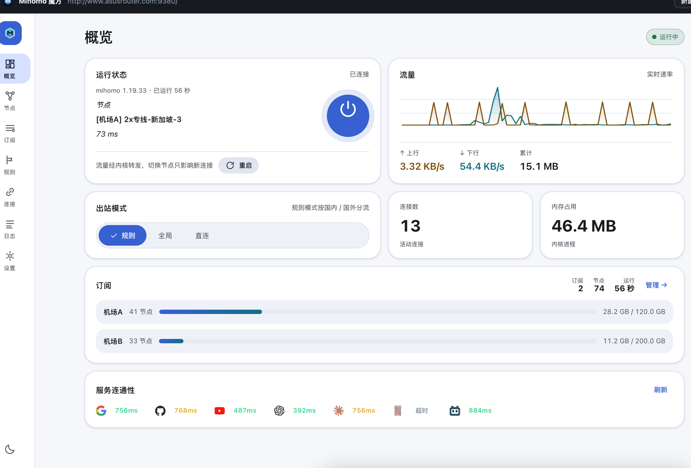
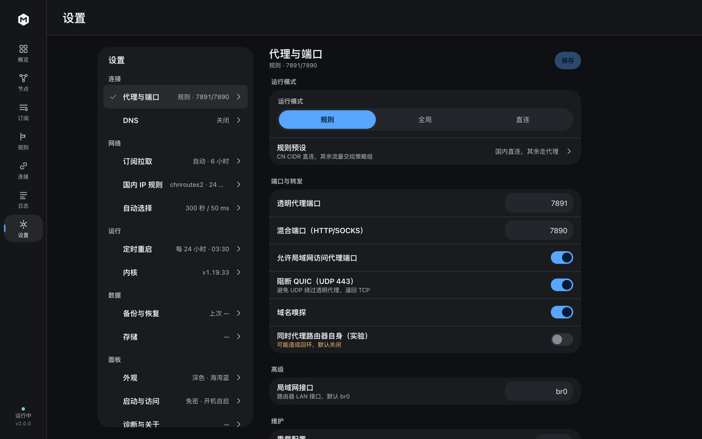

# mihomo-merlin

[](https://github.com/fanghengxuan/mihomo-merlin/actions/workflows/ci.yml)
[](LICENSE)
[](https://github.com/fanghengxuan/mihomo-merlin/releases)

**给华硕梅林路由器用的 mihomo 代理插件**：内核用 [mihomo](https://github.com/MetaCubeX/mihomo)，
自带一个 FlClash 风格的 Web 面板。支持两种固件形态：

- **Asuswrt-Merlin / gnuton（推荐）**：原生安装包，装到 `/jffs`，不需要软件中心
- **koolshare / SWRT**：提供软件中心离线安装包

> 在 **TUF-AX3000 / axhnd.675x（armv7，内核 4.1）** 上实测通过：gnuton/Merlin 版 v2.0.2（安装、引擎启停、overcommit 修复），
> koolshare 版 v2.0.0。同代 axhnd 机型（RT-AX58U / RT-AX3000 / RT-AX56U 等）通常同样适用。

**能力**：订阅管理（链接 / 粘贴导入 / 正则过滤）· 节点分组与测速 · 规则 / 全局 / 直连三种模式 ·
透明代理（iptables REDIRECT）· 实时流量与连接 · 日志流 · 服务连通性与 IP 质量 ·
备份恢复 · DNS（fake-ip）· 国内 IP 规则自动更新 · 定时重启 · 内核在线更新与回滚 · 存储清理 · 开机自启。

## 截图





> v2 实际界面（1440×900，深色）。支持浅色 / 深色 / 跟随系统 / 纯黑，6 套主色；
> 手机访问同一地址会自动切换为 5 项底部 dock + 推入式子页。

## 快速开始

**Asuswrt-Merlin / gnuton：**

1. 到 [Releases](https://github.com/fanghengxuan/mihomo-merlin/releases) 下载 `mihomo-merlin_<版本>_armv7_merlin.tar.gz`
2. 开启 **Administration → System → Enable JFFS custom scripts and configs**
3. `ssh` 上传并安装：

   ```sh
   cd /tmp && tar -xzf mihomo-merlin_<版本>_armv7_merlin.tar.gz
   sh /tmp/mihomo-merlin/install.sh
   ```

4. 浏览器打开 `http://<路由器IP>:9380`
5. 「订阅」→「添加订阅」→ 粘贴机场链接 →「节点」选择分组与节点 →「概览」点电源按钮启动

> 面板重启：`/jffs/mihomo-merlin/ctl.sh restart`；日志在 `/tmp/mihomo/logs/panel.log`。

**koolshare / SWRT 软件中心**：下载 `mihomo-merlin_<版本>_armv7_koolshare.tar.gz`，在软件中心离线安装即可，
详见 §3.2。

> 参与开发或反馈问题见 [CONTRIBUTING.md](CONTRIBUTING.md)。

---

## 1. 面板 v2

### 1.1 七个视图

| 视图 | 内容 |
| --- | --- |
| 概览 | 连接状态与当前节点、实时双序列流量图、出站模式、连接数/内存/节点数/运行时长、订阅摘要、网络身份、服务连通性 |
| 节点 | 按代理组切换、节点列表、单点/整组/全部测速、搜索与排序、延迟四级着色（<600ms / ≥600ms / 超时 / 未测） |
| 订阅 | 订阅卡（状态/格式/节点数/过滤/流量/到期）、添加与编辑、链接或粘贴导入、原始内容、删除 |
| 规则 | 类型 / 内容 / 策略三列，搜索与策略筛选，规则源信息与立即更新 |
| 连接 | 连接数/累计流量、明细表（主机/规则/链路/流量/时长）、搜索、单条或全部关闭 |
| 日志 | SSE 实时日志、级别切换、暂停缓冲、搜索、清屏、自动滚动与「回到最新」 |
| 设置 | 桌面双栏、移动推入式，共 12 个子页 |

### 1.2 设置子页

**连接**：代理与端口 · DNS
**网络**：订阅拉取 · 国内 IP 规则 · 自动选择
**运行**：定时重启 · 内核
**数据**：备份与恢复 · 存储
**面板**：外观 · 启动与访问 · 诊断与关于

表单页按页保存（「保存」按钮脏时点亮）；外观与日志级别即时生效。删除、停内核、关闭全部连接、
回滚内核、恢复备份等操作统一走自定义确认弹窗，不使用浏览器原生 `confirm`。

### 1.3 设计语言

- **四层表面**：`page / card / block / inset` 靠明度分层；列表卡片默认无边框、无阴影。
- **颜色只表状态**：全站一个主色，只用于可操作/可选中；成功、警告、错误只落在文字、图标、chip、进度条。
- **数字优先**：概览关键数字 40px（桌面）/ 34px（移动）、w700、tabular-nums；标签弱化。
- **响应式**：桌面侧栏 7 项；移动端 5 项 dock + 「更多」sheet；<600px 单列。
- **低端降级**：按 CPU 核心数/内存/`prefers-reduced-motion` 自动检测，也可在「外观」手动开关；
  低端下关闭阴影与动画、降低图表点数与轮询频率。

### 1.4 与 FlClash 对照

| FlClash | 本面板 |
| --- | --- |
| 订阅管理、流量用量、到期 | ✅ 支持 `subscription-userinfo` 流量头 |
| 节点列表、按组切换、测速 | ✅ 单点 / 整组 / 全部，600ms 阈值 |
| 规则 / 全局 / 直连 | ✅ 按内核实际生效模式显示，不一致时 warn |
| 规则查看 | ✅ 类型 / 内容 / 策略，搜索与筛选 |
| 实时上下行、连接数、内存 | ✅ SSE 流量 + 60 点图表 |
| 日志 | ✅ SSE，级别 / 暂停 / 清屏 |
| 深浅色、多主色 | ✅ 浅色 / 深色 / 跟随系统 / 纯黑，6 套主色 |
| TUN / 系统代理 | ❌ 路由器使用 iptables 透明代理（见 §4） |
| 内核在线更新 | ✅ 检查 / 下载 / 校验 / 热替换 / 自动回滚 |

前端是**纯原生 HTML/CSS/JS**，没有构建步骤、没有框架、没有 CDN/Web Font，
`embed` 进 Go 二进制，内网完全离线也能打开。

## 2. 它由什么组成

```
┌──────────────────────────── 路由器 ────────────────────────────┐
│                                                                │
│  <安装目录>/bin/mihomo            mihomo 内核（armv7 静态）      │
│  <安装目录>/bin/mihomo-panel      Go 面板：订阅/配置/进程/规则   │
│  <数据目录>/                       设置 / 订阅 / 节点 / 规则      │
│    ├── settings.json              设置                           │
│    ├── subs.json                  订阅列表 + 流量信息            │
│    ├── providers/<id>.json        转换后的节点（proxy-provider） │
│    ├── config.json                生成的 mihomo 配置             │
│    └── rules/chnroute.txt         国内 IP 段                     │
│                                                                │
│  iptables(nat/PREROUTING, br0) ──→ redir :3333 ──→ mihomo      │
└────────────────────────────────────────────────────────────────┘
             ▲                              ▲
     浏览器 http://<路由器>:9380      局域网设备（透明代理）
```

- **mihomo**：armv7 静态构建，不依赖路由器 libc。当前包内是精简版（约 7.9 MB），
  构建标签 `with_low_memory,no_fake_tcp,no_tailscale,no_easytier,no_zerotier`，去掉 gvisor 与组网模块。
  详见 [docs/kernel.md](docs/kernel.md)。
- **mihomo-panel**：自包含 Go 程序，负责订阅抓取/解析、配置生成、内核启停、iptables 维护、
  REST API，并把 `web/**` 嵌入二进制。正常构建约 8.6 MB；`PANEL_UPX=1` 可压到约 2.4 MB。
- **安装位置**：Merlin 为 `/jffs/mihomo-merlin`（数据在 `data/`）；koolshare 为 `/koolshare`
  （程序在 `bin/`，数据在 `mihomo/`）。
- **自启动**：Merlin 用 `/jffs/scripts/services-start`、`services-stop`、`nat-start`；
  koolshare 用 `init.d/S99·N99` 与软件中心菜单。

## 3. 安装

| 固件 | 安装包 | 方式 |
| --- | --- | --- |
| Asuswrt-Merlin / gnuton | `mihomo-merlin_<版本>_armv7_merlin.tar.gz` | 原生安装到 `/jffs`（推荐） |
| koolshare / SWRT | `mihomo-merlin_<版本>_armv7_koolshare.tar.gz` | 软件中心离线安装 |

### 3.1 Asuswrt-Merlin / gnuton（推荐）

1. 下载 `mihomo-merlin_<版本>_armv7_merlin.tar.gz`。
2. 路由器后台开启 **Administration → System → Enable JFFS custom scripts and configs**
   （等价于 `nvram set jffs2_scripts=1 && nvram commit`）。
3. 上传并安装：

   ```sh
   cd /tmp && tar -xzf mihomo-merlin_<版本>_armv7_merlin.tar.gz
   sh /tmp/mihomo-merlin/install.sh
   ```

4. 安装到 `/jffs/mihomo-merlin`，同时写入 `/jffs/scripts/services-start`、
   `services-stop`、`nat-start` 托管块；打开 `http://<路由器IP>:9380`。
5. 卸载：`sh /jffs/mihomo-merlin/uninstall.sh [--keep-data]`。
6. 固件升级后 `/jffs` 通常保留，但 Asus 的升级流程可能改动 `/jffs/scripts`；
   升级完重新执行一次 `install.sh` 即可（钩子块幂等，不会重复叠加）。

说明：

- 已在 **TUF-AX3000 + gnuton 388.11** 实测：安装、面板与引擎启停、overcommit 修复；
  订阅拉取与实际代理链路需配置后验证。
- 仅支持 **armv7l**；TUF-AX3000 v1/v2 在 gnuton 3004 分支的支持列表内。
- `nat-start` 会在防火墙重启 / WAN 重拨后即时重放转发规则；看门狗每 45 秒实测规则是否还在。
- 面板启动时会按 `enabled` 标记自动拉起内核（前提是「开机自启」开启，且首次使用点过一次启动）。
- 日志与内核备份放在 `/tmp/mihomo`（重启清空），不占 jffs；重启后上一版内核备份不再可回滚。
- 升级时先把旧二进制和内核备份移到 `/tmp`，峰值只保留一份新文件，适配 26 MB 级 jffs。
- gnuton 默认 `vm.overcommit_memory=2`，slim 内核会启动失败；面板在启动内核前会自动调整为 0。
- 从源码构建安装包：`./tools/build-merlin-package.sh`（见 §10）。

### 3.2 koolshare / SWRT 软件中心

1. 下载 `mihomo-merlin_<版本>_armv7_koolshare.tar.gz`。
2. 路由器后台 →「软件中心」→「离线安装」→ 选择该文件。
3. 安装完成后打开 `http://<路由器IP>:9380`。

没有软件中心入口时，也可以手动安装：

```sh
cd /tmp && tar -xzf mihomo-merlin_<版本>_armv7_koolshare.tar.gz
sh /tmp/mihomo/install.sh
```

`install.sh` 会做机型/架构/空间检查，安装后登记菜单（有 `dbus` 时）并启动面板。

### 3.3 首次使用

1. 打开面板，进入「订阅」→「添加订阅」，粘贴机场链接（Clash YAML / base64 节点列表都支持）。
2. 回到「概览」点电源按钮启动；LAN 设备自动走规则模式（国内直连、其余走代理）。
3. 在「节点」页切换节点或点「全部测速」挑选低延迟节点。

## 4. 透明代理是怎么生效的

启动时面板会：

1. 生成 `config.json`（`redir-port: 3333`、`mixed-port: 7890`、`external-controller: 127.0.0.1:9090`）。
2. 用 `mihomo -t` 校验配置，失败时把内核原文返回给前端，不会「启动了但秒退」。
3. 启动内核，等 REST API 就绪后写 iptables：

```sh
iptables -t nat -N MIHOMO
# 内网/保留地址/代理服务器 IP 一律放行，避免死循环
iptables -t nat -A MIHOMO -d 192.168.0.0/16 -j RETURN   # 等 8 条保留网段
iptables -t nat -A MIHOMO -d <代理服务器IP> -j RETURN
iptables -t nat -A MIHOMO -p tcp -j REDIRECT --to-ports 3333
iptables -t nat -I PREROUTING 1 -i br0 -j MIHOMO        # 只拦 LAN 转发流量
iptables -I FORWARD 1 -p udp --dport 443 -j REJECT      # 阻断 QUIC，逼回 TCP
```

4. 看门狗每 45 秒检查一次；重启防火墙或路由器重拨冲掉规则后会自动补回来。

**为什么不用 TUN**：ASUS 固件的路由表/策略路由由厂商脚本托管，TUN + auto-route 容易把
WAN、NTP、DDNS 一起卷进去；`nat REDIRECT` 只作用于 `br0` 转发流量，风险面更小。

**为什么不接管 DNS**：接管 DNS 要么改 dnsmasq（会破坏 `router.asus.com` 等内网域名），
要么劫持 53 端口（会让路由器自身 DNS 绕圈）。默认保留系统 DNS + 真实 IP，用 `chnroute` 做 IP 分流，
同时开启 `sniffer`（从 TLS SNI / HTTP Host 反解域名），便于后续加域名规则。

## 5. jffs 空间不足怎么办

Merlin 安装器会在写入前检查 `/jffs`；空间不足时先卸载旧版或清理其它插件。
如果使用 koolshare 软件中心，它在**解压前**就会检查（`剩余 - 2048KB 预留 < 解压后大小`），
此时插件的 `install.sh` 还没运行，可以用独立清理脚本：

```sh
# 路由器上（ssh），先预览可清理项（不会删除任何东西）
sh mihomo-cleanup.sh

# 确认后真删，并判断空间够不够装
sh mihomo-cleanup.sh --yes --need 18300
```

脚本只处理 koolshare 安装路径（数据目录、两个二进制、菜单页、图标、脚本、自启软链、`/tmp` 旧日志），
会列出内核备份明细并报告释放空间。

| 包 | tar.gz | 解压占用 | 需要 jffs |
| --- | --- | --- | --- |
| 含内核（当前发布物） | 11 MB | 16.2 MB | ≥ 17.9 MB |

如果清理后仍不够，可先换成更小的内核，或按 §10 自行裁剪包内容。
内核 Release：[fanghengxuan/mihomo](https://github.com/fanghengxuan/mihomo) 的 `slim-*`。

## 6. 内核在线更新

「设置 → 内核」：

- 显示当前版本、大小、安装时间、SHA-256、可回滚版本。
- **检查更新 / 立即更新**：查询 [fanghengxuan/mihomo](https://github.com/fanghengxuan/mihomo) 的 `slim-*` Release，
  匹配 `mihomo-linux-armv7-slim-*` 资产；下载后校验 ELF / `-v` / `-t`，失败自动回滚。
- 也支持拖入或选择本地内核（原始 ELF 或 `.gz`，上限 96 MB）。
- 服务端依次校验：ELF 架构 → `-v` → 用当前配置 `-t` → 备份旧版本 → 替换并重启；任一步失败不写盘。
- 「回滚上一版本」随时可切回，新旧备份最多保留 3 个。

接口见 [docs/API.md](docs/API.md) §7。

## 7. 与参考项目的关系

- **[MetaCubeX/mihomo](https://github.com/MetaCubeX/mihomo)**：直接使用官方配置格式与发布二进制，不做 patch。
- **[hq450/fancyss](https://github.com/hq450/fancyss/tree/3.0)**：安装形态参考它——`/koolshare` 布局、
  `install.sh`、`init.d/S99·N99`、`dbus` 菜单、`chnroute.txt` 来源；但实现是**单个 mihomo 内核 + 单个 Go 面板**，
  没有 CGI、websocketd 或多进程拼接。
- **[chen08209/FlClash](https://github.com/chen08209/FlClash)**：借鉴其表面体系、导航结构、卡片与数字层级；
  FlClash 是 Flutter 客户端，路由器上用 Web 面板实现同类交互。

## 8. 目录结构

```
mihomo-merlin/
├── build.sh                  打包脚本（交叉编译 + 拉内核/规则 + 出 tar.gz）
├── main.go / api.go          HTTP 服务、路由、鉴权
├── config.go                 生成 mihomo config.json
├── engine.go                 内核进程 / iptables / 看门狗
├── clashapi.go               mihomo REST API 客户端
├── subs.go                   订阅抓取、流量头解析、定时更新
├── parse.go                  订阅格式识别与节点链接解析
├── hub.go                    流量/日志 SSE 分发
├── settings.go / util.go
├── web/                      面板前端（embed 进二进制）
│   ├── index.html
│   ├── app.css
│   ├── css/tokens.css
│   └── js/
│       ├── 00-core.js … 90-main.js
│       └── views/            7 个视图 + 设置 + 更多 sheet
├── plugin/
│   ├── merlin/               Asuswrt-Merlin 原生安装（推荐）
│   └── scripts/ · webs/      koolshare 软件中心插件骨架
├── tools/
│   └── build-merlin-package.sh
├── tests/
│   ├── ui_check.py           前端静态检查（扫描 web/**）
│   ├── e2e.sh                静态检查 + 单测 + 真实内核 e2e + 安装冒烟
│   ├── install_smoke.sh      软件中心安装/卸载冒烟
│   └── merlin_install_smoke.sh  Merlin 原生安装冒烟
├── docs/
│   ├── API.md                HTTP API 契约
│   ├── kernel.md             内核构建与取舍
│   └── ui-redesign/          v2 设计规范、执行计划、验收报告
└── dist/                     打包产物（gitignore）
```

## 9. 已知限制

- **只支持 armv7l**：aarch64 机型（AX86U 等）需另编 `GOARCH=arm64` 的包。
- **不支持 UDP 转发**：`redir` 只代理 TCP；QUIC 被 REJECT 后自动回落 TCP。完整 UDP 需 `tproxy` + `ip rule`，暂未实现。
- **不接管 DNS**：见 §4；域名级规则依赖嗅探。
- **TUN 需要 system 栈**：包内精简内核无 `with_gvisor`，若启用 TUN 必须写 `tun.stack: system`。
- **面板走 HTTP**：建议只在可信 LAN 内使用；外网访问请自行反代 + HTTPS，并设置面板密码。
- **「同时代理路由器自身」是实验项**：默认关闭。
- 订阅协议覆盖 `ss / ssr / vmess / vless(reality) / trojan / hysteria / hysteria2 / tuic / socks5`。
- **前端体积**：`web/` 原始约 332 KB（JS gzip 后约 58 KB），超过设计规范的自定目标；
  已按 [docs/ui-redesign/spec.md](docs/ui-redesign/spec.md) §10.3-7 记录为接受例外，以换取无构建、源码可直接维护。
- **真机验证范围**：Merlin 版 v2.0.2 已在 TUF-AX3000 + gnuton 388.11 验证安装、面板/引擎启停、
  overcommit 修复与 iptables 清理；订阅拉取与实际代理链路需配置后验证。koolshare 版 v2.0.0 已在同机型实测通过。

## 10. 构建

```sh
# 依赖：Go 1.23+（go.mod）、curl、tar、gzip
cd mihomo-merlin
GO=$HOME/go/bin/go ./build.sh                 # 完整包（含 slim 内核与 chnroute）
./build.sh --kernel /path/to/mihomo           # 用指定内核
./build.sh --no-download                      # 只用 .cache 里的内核/规则
./build.sh --dev                              # 额外编译本机可跑的 panel
```

产物在 `dist/`：

- Merlin：`mihomo-merlin_<版本>_armv7_merlin.tar.gz`，由 `tools/build-merlin-package.sh` 生成
- koolshare：`mihomo-merlin_<版本>_armv7_koolshare.tar.gz` + `.sha256`

## 11. 开发与测试

```sh
# 单元测试（设置 MM_MIHOMO 时会跑真实内核集成测试）
go test ./...
MM_MIHOMO=/path/to/mihomo MM_NO_IPTABLES=1 go test ./...

# 前端静态检查：HTML 结构 / id 引用 / 全部 JS 语法 / 脚本顺序与版本戳 /
# 禁用模式（window.confirm、color-mix、backdrop-filter、外链）/ 关键类名 / 视图注册
python3 tests/ui_check.py

# 一键：静态检查 + 单元测试 + 真实内核 e2e + 安装冒烟
sh tests/e2e.sh

# 安装/卸载冒烟（假根目录 + 桩命令，不需要 ARM 环境）
sh tests/install_smoke.sh
sh tests/merlin_install_smoke.sh
```

本地调试面板：

```sh
MM_DATA_DIR=/tmp/mmdata MM_MIHOMO=$(command -v mihomo) MM_NO_IPTABLES=1 \
  ./dist/stage/mihomo/bin/mihomo-panel -listen :9380
```

## 12. 排障

| 现象 | 排查 |
| --- | --- |
| 软件中心提示「不是 ASUS hnd 平台的离线包」 | 包根目录需有 `.valid`（内容 `hnd`），ASP 里需有 `PKG_ARCH="hnd"` |
| 安装时提示空间不足 | 见 §5 |
| 面板打不开 | `pidof mihomo-panel`；Merlin 日志在 `/tmp/mihomo/logs/panel.log`，koolshare 在 `/koolshare/mihomo/logs/panel.log` |
| 提示「配置校验失败」 | 按提示修改订阅或节点；内核原文在对应数据目录的 `logs/mihomo.log` |
| 节点列表为空但订阅正常 | 看订阅卡错误信息，或「原始内容」确认服务器返回了什么 |
| 启动成功但没法上网 | `iptables -t nat -L MIHOMO -n -v` 看规则；`iptables -t nat -L PREROUTING -n` 看跳转 |
| 重启防火墙后失效 | `nat-start` 会即时重放；看门狗 45 秒兜底。Merlin：`/jffs/mihomo-merlin/ctl.sh reapply` |
| 想看内核输出 | 面板「日志」页，或 `tail -f` 数据目录下的 `logs/mihomo.log` |

## 13. 许可与出处

- 本项目源码：**MIT**，见 [LICENSE](LICENSE)。
- 安装包内含 mihomo 内核（[MetaCubeX/mihomo](https://github.com/MetaCubeX/mihomo)，**GPL-3.0**）。
  内核是独立可执行文件、通过配置文件与进程交互，本仓库不包含其源码；再分发请遵守 GPL-3.0，
  并在发布页注明内核版本与来源。
- 面板与配置逻辑单独实现，未复制 FlClash 代码；安装契约参考 fancyss / MerlinClash Lite。

## 更新记录

见 [CHANGELOG.md](CHANGELOG.md)。当前版本 **2.0.3**：面板重构 + 稳定性与 Merlin 安装修复。
